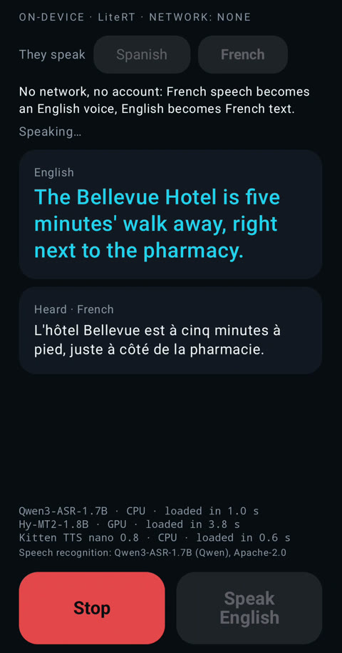
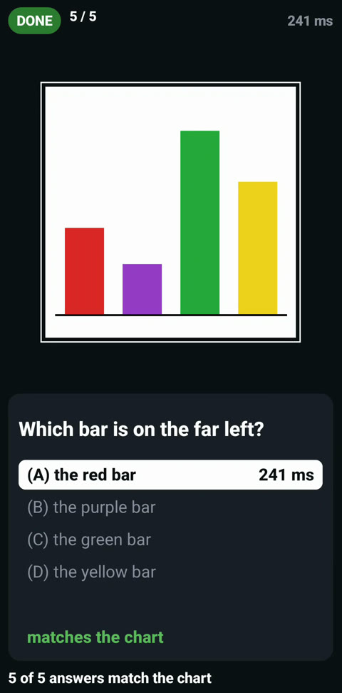
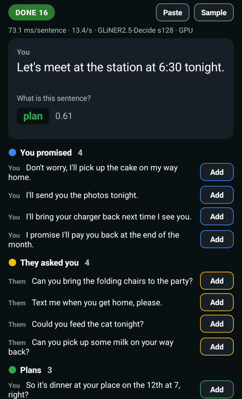

# hfmodels for Android

An Android library for LiteRT models on Hugging Face: give it a model id and get a model you can chat with on the phone, offline after one download. This is an independent, third-party library, not affiliated with Google, Hugging Face or the model publishers.

| Speech to speech, offline | Questions about a picture | Sorting a chat |
|:---:|:---:|:---:|
|  |  |  |

I recorded these on a Galaxy S26. All three are samples in this repo, along with [a plain chat app](samples/chat).

```kotlin
val models = HfModels(applicationContext)
val chat = models.fromPretrained(
    ModelRef("litert-community/gemma-4-E2B-it-litert-lm"), Tasks.Chat
) { event -> show(event) }
val session = chat.createConversation(
    ConversationConfig(systemInstruction = Contents.of("You are a helpful assistant."))
)
session.stream(Contents.of("What is 17 + 25? Answer briefly."))
    .collect { message -> append(message) }
withContext(NonCancellable) { chat.closeAndJoin() }
```

`show` and `append` are your own functions, and the calls run in a coroutine.

The SDK runs on LiteRT-LM, Google's on-device runtime. It downloads the model at a fixed commit, resumes a broken download and checks each file's sha256. Then it picks a backend the device can run. Cancelling the stream stops the model, and `closeAndJoin()` waits for the native side to finish.

The current release is 0.3.0, and the API may still change before 1.0. I verified chat on a Pixel 8a while building 0.1.0 and 0.1.1, typed decisions on a Galaxy S26 while building 0.1.2 and 0.2.0, and voice on the same phone while building 0.2.0. With 0.3.0's runtime, LiteRT-LM 0.19.1, I ran chat and voice on a Pixel 11 Pro and a vision-language model on a Pixel 8a ([tested-runtime-matrix.json](tested-runtime-matrix.json)).

## Add it

The SDK needs Android 12 / API 31 on `arm64-v8a`, and your app needs compileSdk 36:

```kotlin
// settings.gradle.kts: repositories google() and mavenCentral()
// app/build.gradle.kts
android {
    compileSdk = 36
    defaultConfig {
        minSdk = 31
        ndk { abiFilters += "arm64-v8a" }
    }
}
dependencies { implementation("io.github.john-rocky.hfmodels:hfmodels-litertlm:0.3.0") }
```

From 0.3.0 your app also needs Kotlin 2.3.0 or newer. Android Gradle Plugin 9.3.1 has Kotlin 2.2.10 built in, which is too old. With that plugin, put `classpath("org.jetbrains.kotlin:kotlin-gradle-plugin:2.3.21")` in the root buildscript.

The first example downloads Gemma 4, which is 2.6 GB. [The walkthrough](docs/getting-started.md) starts with the smaller [LFM2.5-1.2B-Instruct](https://huggingface.co/litert-community/LFM2.5-1.2B-Instruct), a 736 MB download, and ends with what to check if the first reply fails.

## Models

The SDK can load a model if its repo has an `hfmodels.json` file or its own catalog lists it. These are good first picks, and all four ran on a Pixel 8a with LiteRT-LM 0.16.1 and on a Pixel 11 Pro with LiteRT-LM 0.19.1:

| Model id | Download | Input | Ran on |
|---|---|---|---|
| `litert-community/LFM2.5-1.2B-Instruct` | 0.7 GB | text | GPU, CPU |
| `litert-community/Qwen3-1.7B` | 1.0 GB | text, with reasoning | GPU, CPU |
| `litert-community/LFM2.5-VL-1.6B` | 1.3 GB | text and image | GPU, CPU |
| `litert-community/gemma-4-E2B-it-litert-lm` | 2.6 GB | text and image | GPU, CPU |

[Models](docs/models.md) lists all 21 ids and what happened on each backend.

## Classify text

A decision model reads a text and answers a question with fixed options. It returns a probability for each option instead of generating text. Add `io.github.john-rocky.hfmodels:hfmodels-litert:0.3.0`, and set `android.uniquePackageNames=false` in `gradle.properties`:

```kotlin
val model = models.fromPretrained(
    ModelRef("litert-community/laya-LiteRT", variant = "ml_s256_fp32"), EncoderDecisions
)
val d = model.decide(
    mapOf("subject" to "Duplicate charge", "body" to "Please refund the duplicate charge."),
    mapOf(
        "department" to Question.Choice(
            "Which department should handle this request?",
            linkedMapOf(
                "billing" to "invoices, payments, refunds",
                "technical" to "bugs, outages",
                "other" to "everything else",
            ),
        ),
    ),
)
(d.answers["department"] as Answer.Choice).choice        // "billing"
```

One question took a median of 54 ms on a Galaxy S26's GPU with that model.

## Voice

`VoiceLoop` is an offline voice assistant. It transcribes a spoken request, lets the chat model call the phone's clock and calendar, and speaks the answer. Add `io.github.john-rocky.hfmodels:hfmodels-voice:0.3.0`, set `android.uniquePackageNames=false` in `gradle.properties`, and declare the permissions listed on [the voice page](docs/voice.md):

```kotlin
val asr = HfModels(app).fromPretrained(
    ModelRef("litert-community/Zipformer-medium-CR-CTC-LiteRT"), Transcribe)
val tts = HfModels(app).fromPretrained(
    ModelRef("litert-community/kitten-tts-nano-0.8"), Speak)
val chat = HfModels(app).fromPretrained(
    ModelRef("litert-community/gemma-4-E2B-it-litert-lm"), Tasks.Chat)
val loop = VoiceLoop(asr, chat, tts, PhoneTools.all(app), VoiceLoopConfig(player = SpeechPlayer()))
// per utterance: Heard, Thinking, ToolCalled, Speaking, Done
loop.listen(MicSource().chunks()).collect { e -> show(e) }
```

On a Galaxy S26 in airplane mode, with LiteRT-LM 0.16.1, the first sound came 2.6 s after the end of a recorded command in one run and 3.0 s in another. Of that, 0.8 s is the silence the loop waits for to know the command has ended. The recordings are synthetic, and I have not measured the loop with a person's voice.

## Samples

Each sample installs from a clone with Gradle, for example `./gradlew :samples:voice:installDebug`. There is no prebuilt APK.

| To try | Open | What it does |
|---|---|---|
| Chat | [`samples/chat`](samples/chat) | The chat screen, with first-token time and tok/s under each answer |
| Voice | [`samples/voice`](samples/voice) | Ask by voice to set an alarm or a timer, offline |
| Translation | [`samples/translate`](samples/translate) | French or Spanish speech to an English voice, and English speech back as text |
| Photo questions | [`samples/ask`](samples/ask) | Ask about your photo and pick from two to five options |
| Photo search | [`samples/eg2search`](samples/eg2search) | Say what is in a photo and find it in your album |
| Sorting a chat | [`samples/promises`](samples/promises) | Sorts a conversation into promises, requests and plans |
| Classify text | [`samples/decide`](samples/decide) | Four demo screens that show how long each decision took |
| Side by side | [`samples/loops`](samples/loops) | Asks two builds of one model the same question, with timings |

## For coding agents

[`AGENTS.md`](AGENTS.md) tells a coding agent how to use this SDK. To add the matching skill to your app's repository:

```sh
mkdir -p .claude/skills/hfmodels-android && curl -fsSL https://raw.githubusercontent.com/john-rocky/hfmodels-android/main/skills/hfmodels-android/SKILL.md -o .claude/skills/hfmodels-android/SKILL.md
```

## Documentation

- [Getting started](docs/getting-started.md): the first reply on a phone, step by step
- [API](docs/api.md): every public type, with imports and signatures
- [Typed decisions](docs/typed-decisions.md): the supported models, their speed and running on the NPU
- [Voice](docs/voice.md): the permissions and the measurements
- [Publishing a model](docs/publishing.md): how to make your own repo loadable by id
- [Error codes](docs/errors.md): each `ModelException.code` and the fix
- [Loading, sessions and reasoning models](docs/usage.md)
- [What the SDK replaces](docs/why.md): the code you would otherwise write by hand
- [Repository layout](docs/layout.md)
- [Version history](docs/status.md)

## License

Apache-2.0 for the SDK. Each model has its own license, named in its `hfmodels.json`. The SDK displays it but does not check it.
